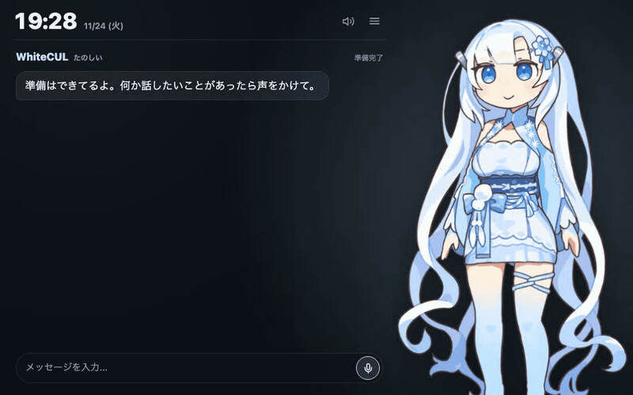
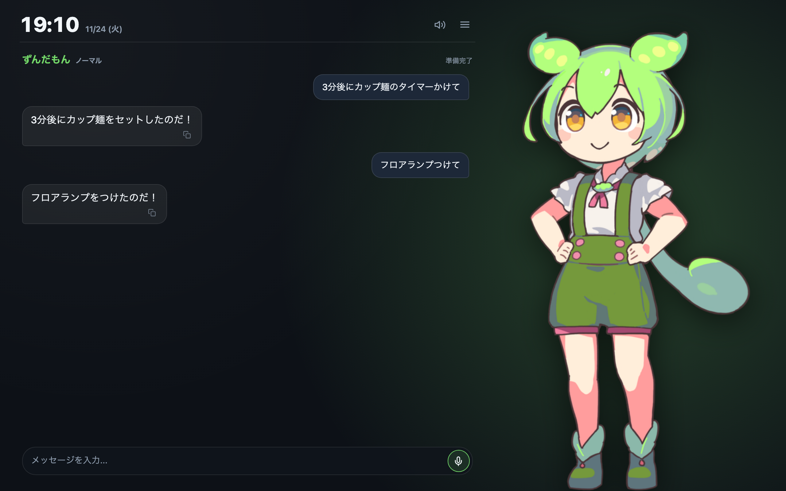
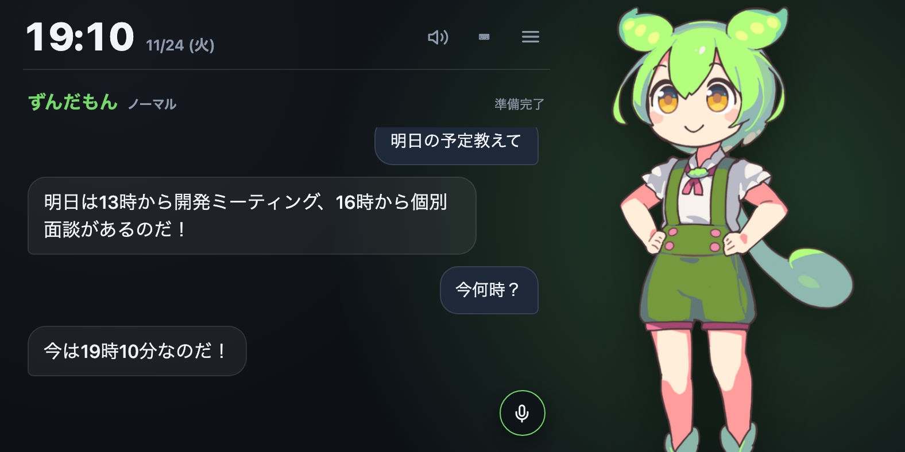
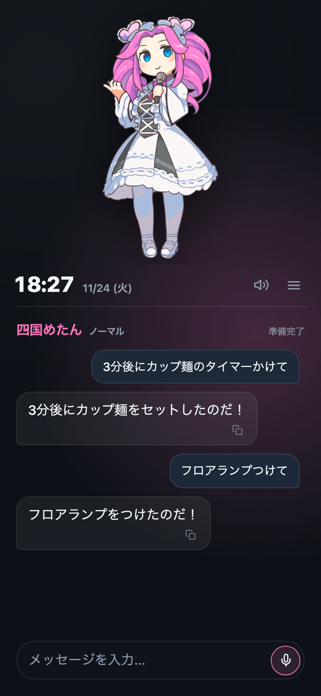
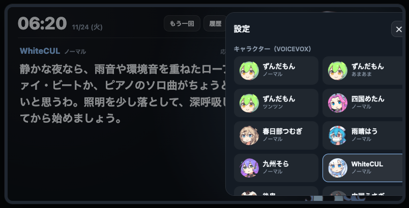

# VoxMate

[日本語](README.md) | **English**

A **cross-platform, multi-device personal voice assistant** combining local Whisper STT (`mlx-whisper` / `faster-whisper`), deterministic fast-path routing, pluggable AI agents (`agy` / `claude`), and VOICEVOX speech synthesis.

While keeping conversation history and alarm dismissal synced across PC, smartphones, and Echo Show 5 in real time, VoxMate handles routine tasks (clock, timers, SwitchBot home control) in sub-second latency without calling an LLM, and seamlessly delegates complex research, calendar, and mail tasks to your AI agent.

## Demo & Screenshots

> [!NOTE]
> A compact walkthrough showcasing expressive portrait & arm-pose transitions, phoneme-synced lip-sync, chat input, and timer controls.



| PC (Wide Layout) | Echo Show 5 (`788×394`) |
| :---: | :---: |
|  |  |

| Smartphone (Portrait) | Settings Panel (Volume Split & Model Select) |
| :---: | :---: |
|  |  |

## Supported Characters (12 Characters / 23 Styles)

Switch characters and speaking styles with a single tap from the settings panel (AI persona, theme accent color, and character portraits update automatically).

| Icon | Character | Styles | Icon | Character | Styles |
| :---: | :--- | :--- | :---: | :--- | :--- |
|  | **Zundamon** | Normal / Sweet / Tsundere |  | **Goki** | Human ver. / Plush ver. |
|  | **Shikoku Metan** | Normal / Sweet / Tsundere |  | **Chugoku Usagi** | Normal / Surprised |
|  | **Kasukabe Tsumugi** | Normal |  | **Tohoku Zunko** | Normal |
|  | **Amehare Hau** | Normal |  | **Tohoku Itako** | Normal |
|  | **Kyushu Sora** | Normal / Sweet / Tsundere |  | **Ankomon** | Normal / Confident / Sleepy |
|  | **WhiteCUL** | Normal / Fun |  | **Buibui Kobako** | Normal |

## Key Features

- **Expressive Companion & Phoneme Lip-Sync**:
  - LLM automatically tags per-sentence emotions (`happy`, `shy`, `surprised`, `angry`, `sad`, `pale`, `playful`, etc.), driving expressions, arm poses, and subtle CSS motions across all 12 characters
  - VOICEVOX phoneme-synced vowel (`a/i/u/e/o`) and closed-mouth lip-sync across all emotions, natural blinking/listening gestures, and character-specific gimmicks
  - Hands-free wake-word & hybrid follow-up listening mode
- **Multi-Device Responsive UI**:
  - **PC**: Integrated input bar (`Enter` for newline, `Cmd/Ctrl + Enter` to send, paper-plane send icon) + full-height character portrait
  - **Echo Show 5**: Compact floating mic/cancel controls and a large centered alarm stop modal
  - **Smartphone**: Portrait-background layout tailored for mobile browsers
- **Deterministic Fast-Path (`fast_path.py`)**:
  - Instant sub-second responses without LLM roundtrips for clock/date, timer/alarm CRUD, and simple SwitchBot ON/OFF commands
- **Wake-Up Alarm & Volume Separation**:
  - Independent **Conversation Volume** (chat, chimes, `reminder`) and **Alarm Volume** (looping `alarm`) sliders with live preview chimes
  - Stopping an alarm on one device automatically dismisses it across all connected devices
- **Pluggable AI Backends (`backends/`)**:
  - Switch between `agy` (persistent Antigravity CLI session), `claude` (Claude Code CLI), or `gemini` (official Gemini Developer API via `GEMINI_API_KEY`) using `VOXMATE_BACKEND`
- **Workspace Isolation (`VOXMATE_WORKDIR`)**:
  - Automatically loads `VOXMATE.md`, `MEMORY.md`, and `SOUL.md` from your workspace so personal data stays cleanly separated
- **Calendar, Mail & Smart Home Templates (`examples/`)**:
  - Includes `sb` (SwitchBot CLI) and ready-to-adapt templates in `examples/` for Google Calendar and mail search/summaries (with send-disabled prompt guardrails)

## Architecture

- **STT**: `mlx-whisper` on Apple Silicon macOS / `faster-whisper` on Linux & Windows (auto-selected via `uv sync`) + Silero VAD
- **Fast-Path**: `fast_path.py` (clock, timers, cached SwitchBot matching)
- **LLM Backends**: `backends/agy.py` (`agy`) / `backends/claude.py` (`claude`) / `backends/gemini.py` (`gemini`)
- **TTS**: VOICEVOX Engine (`http://127.0.0.1:50021`) + Web Audio gain control & phoneme-synced lip-sync

---

## Setup Guide

### 1. Prerequisites

- macOS (Apple Silicon) / Linux / Windows
- Python 3.12+ / [`uv`](https://docs.astral.sh/uv/)
- `ffmpeg` / `jq` (for audio conversion and `tools/sb`, `tools/timer`)
- An AI backend CLI (`agy` or `claude`)

### 2. Clone & Install Dependencies

```bash
git clone https://github.com/Naruto-Takahashi/voxmate.git
cd voxmate
uv sync
```

### 3. VOICEVOX Engine & Character Portraits

> [!IMPORTANT]
> This public repository does not bundle redistributable character portrait assets or the large VOICEVOX Engine binary.
> Even without portrait images, VoxMate automatically falls back to character-colored placeholder visuals, so **you only need VOICEVOX Engine to get started**.

1. **Install VOICEVOX Engine**:
   - **macOS (arm64)**:
     1. Download `voicevox_engine-macos-arm64-*.tar.gz` (or `.zip`) from [VOICEVOX Engine Releases](https://github.com/VOICEVOX/voicevox_engine/releases)
     2. Extract its contents (`run` binary, etc.) into `voicevox/macos-arm64/` (`./start.sh` launches it automatically)
   - **Linux / Windows**:
     - Start VOICEVOX Engine via Docker or native build listening on `http://127.0.0.1:50021`
     - Docker example: `docker run --rm -p 50021:50021 voicevox/voicevox_engine:cpu-latest`
2. **Character Portraits (Optional)**:
   - To display full-height portraits as shown in the screenshots, obtain assets according to the creator's terms (e.g., [Sakamoto Ahiru's distribution page](https://tachie.net/u/3)) and place PNG files in `static/portraits/`
   - Naming convention: `<asset>_{idle,speak,blink,happy,think,icon}.png` (e.g., `zundamon_idle.png`, `zundamon_icon.png`)

> [!TIP]
> If `static/portraits/` is empty, VoxMate renders clean character-colored orb placeholders and initial badges with zero broken-image icons.

### 4. Choose AI Backend & Start

Antigravity CLI (`agy`) is used by default. Set `VOXMATE_BACKEND=claude` for Claude Code CLI, or `VOXMATE_BACKEND=gemini` (with `GEMINI_API_KEY`) for the official Gemini Developer API.

```bash
# macOS (starts VOICEVOX Engine + VoxMate)
./start.sh

# macOS with Claude Code
VOXMATE_BACKEND=claude ./start.sh

# macOS with official Gemini API
GEMINI_API_KEY="your_api_key" VOXMATE_BACKEND=gemini ./start.sh

# Linux / Windows (with VOICEVOX Engine already running)
uv run python -m uvicorn server:app --host 127.0.0.1 --port 8000
```

Open `http://127.0.0.1:8000` in your browser.

#### Connecting Echo Show 5 & Smartphones

- **Echo Show 5 (USB Debugging / adb)**: `start.sh` automatically maintains `adb reverse tcp:8000 tcp:8000`, so Silk Browser can open `http://localhost:8000`.
- **Smartphones / Other Devices**: Expose `http://127.0.0.1:8000` over HTTPS using Tailscale Serve (or similar) to enable microphone access.

> [!WARNING]
> VoxMate has no built-in login authentication. Do not expose `--host 0.0.0.0` directly to public networks or untrusted LANs; use `127.0.0.1` with Tailscale Serve or `adb reverse`.

---

## Optional Integrations

### SwitchBot Control (`tools/sb`)

1. Copy `.env.example` to `.env` and add your SwitchBot API v1.1 credentials (keep `.env` out of Git).

```bash
SWITCHBOT_TOKEN="your_token"
SWITCHBOT_SECRET="your_secret"
```

2. Fetch your device list once to build the local cache for fast-path name matching:

```bash
./tools/sb devices --refresh
```

### Workspace Extensions (`VOXMATE.md`)

Place `VOXMATE.md` and `MEMORY.md` inside `VOXMATE_WORKDIR` (default: `./chat_workspace`) to inject custom instructions and memory into the voice prompt.

- Generic prompt template: [`examples/VOXMATE.md`](examples/VOXMATE.md)
- Calendar, mail, timer & SwitchBot skill template: [`examples/secretary-ops-template.md`](examples/secretary-ops-template.md)

### Environment Variables

| Variable | Default | Description |
| :--- | :--- | :--- |
| `VOXMATE_BACKEND` | `agy` | AI backend (`agy` / `claude`) |
| `VOXMATE_WORKDIR` | `./chat_workspace` | Agent working directory (`VOXMATE.md`, etc.) |
| `AGY_MODEL` | `gemini-3.8-flash-low` | Initial model when using `agy` |
| `CLAUDE_MODEL` | `""` | Model override when using `claude` |
| `VOICEVOX_URL` | `http://127.0.0.1:50021` | VOICEVOX Engine URL |
| `VOICEVOX_SPEAKER` | `3` | Default speaker ID (`3`: Zundamon) |
| `SWITCHBOT_ENV_FILE` | `.env` | Path to SwitchBot credentials file |
| `SWITCHBOT_CACHE_FILE` | `.cache/switchbot-devices.json` | Path to SwitchBot device cache |

---

## Credits

- **Character Portraits (in screenshots)**: Sakamoto Ahiru ([Distribution Page](https://tachie.net/u/3) and VOICEVOX character portrait assets)
  - Portrait assets are excluded from this repository in accordance with the creator's distribution terms.
- **Voice Synthesis**: [VOICEVOX](https://voicevox.hiroshiba.jp/)
  - Zundamon, Shikoku Metan, Kasukabe Tsumugi, Amehare Hau, Kyushu Sora, WhiteCUL, Goki, Chugoku Usagi, Tohoku Zunko, Tohoku Itako, Ankomon, Buibui Kobako (subject to each character's terms of use).

## License

- Source code in this repository is licensed under the [MIT License](LICENSE) (external voice and portrait assets belong to their respective rights holders).
