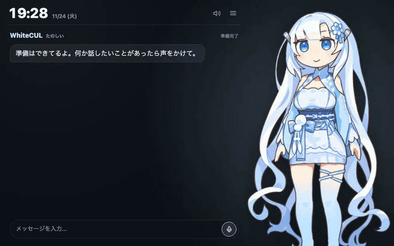
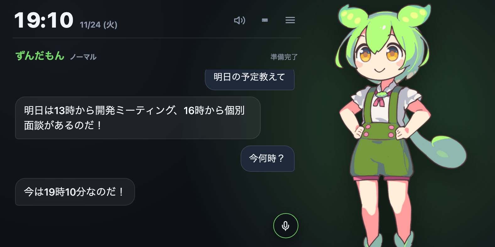
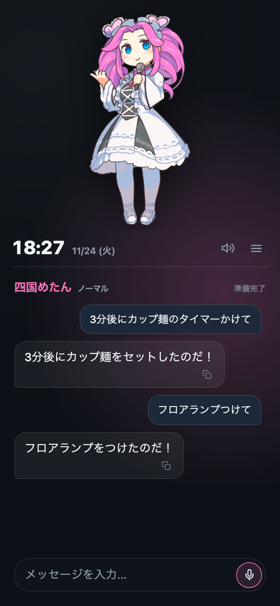

# VoxMate

**日本語** | [English](README.en.md)

ローカル音声認識・決定論的ファストパス・差し替え可能な AI エージェント（`agy` / `claude`）・VOICEVOX 音声合成を統合した、**クロスプラットフォーム＆マルチデバイス対応のパーソナル音声アシスタント** です。

PC・スマホ・Echo Show 5 で画面とアラームを同期しながら、時計・タイマー・SwitchBot 操作は 0 秒台で即答し、カレンダー・メール確認や複雑な会話は AI エージェントへ引き継ぎます。

## デモ・スクリーンショット

> [!NOTE]
> 以下は初回リリース時のデモであり、UIは変更される場合があります。



| PC（ワイド画面） | Echo Show 5（`788×394`） |
| :---: | :---: |
|  |  |

| スマートフォン（縦画面） | 設定パネル（音量分離・モデル選択） |
| :---: | :---: |
|  |  |

## 対応キャラクター一覧（12キャラクター・23スタイル）

設定パネルからワンタップでキャラクター・口調を切り替えられます（選択に応じて AI の口調・テーマカラー・立ち絵も連動します）。

| アイコン | キャラクター | 対応スタイル | アイコン | キャラクター | 対応スタイル |
| :---: | :--- | :--- | :---: | :--- | :--- |
|  | **ずんだもん** | ノーマル / あまあま / ツンツン |  | **後鬼** | 人間ver. / ぬいぐるみver. |
|  | **四国めたん** | ノーマル / あまあま / ツンツン |  | **中国うさぎ** | ノーマル / おどろき |
|  | **春日部つむぎ** | ノーマル |  | **東北ずん子** | ノーマル |
|  | **雨晴はう** | ノーマル |  | **東北イタコ** | ノーマル |
|  | **九州そら** | ノーマル / あまあま / ツンツン |  | **あんこもん** | ノーマル / つよつよ / けだるげ |
|  | **WhiteCUL** | ノーマル / たのしい |  | **ブイブイ・コバコ** | ノーマル |

## 主な機能

- **マルチデバイス対応 UI**:
  - **PC**: 統合入力バー（`Enter` で改行、`Cmd/Ctrl + Enter` で送信、紙飛行機送信アイコン）＋ 右側フルハイト立ち絵
  - **Echo Show 5**: コンパクトなフローティングマイク・キャンセルボタン、大型アラーム停止モーダル
  - **スマートフォン**: 背景立ち絵＋モバイル最適レイアウト
- **決定論的ファストパス (`fast_path.py`)**:
  - 現在時刻・日付、タイマー/アラーム登録・一覧・キャンセル、SwitchBot 単純 ON/OFF を LLM を通さず 0 秒台で即実行・音声返答
- **目覚まし対応アラーム ＆ 音量分離**:
  - **会話音量**（普段の会話・操作音・`reminder`）と **アラーム音量**（目覚まし・`alarm`）を独立して設定可能（スライダー操作時の試し鳴らし付き）
  - アラーム発火時は画面中央に大型「停止」モーダルを表示し、1 台で止めると接続中の全端末で連動停止
- **差し替え可能な AI バックエンド (`backends/`)**:
  - 環境変数 `VOXMATE_BACKEND` で `agy`（Antigravity CLI 常駐セッション）または `claude`（Claude Code CLI）を選択可能
- **ワークスペース分離 (`VOXMATE_WORKDIR`)**:
  - `VOXMATE.md`・`MEMORY.md`・`SOUL.md` を指定ワークスペースから自動読み込みするため、個人環境を別リポジトリに安全に分離可能
- **カレンダー・メール・スマートホーム連携（拡張テンプレート同梱）**:
  - SwitchBot（`sb` CLI による家電・プラグ操作）、Google カレンダー（予定の確認・登録）、メール検索・要約（送信禁止のプロンプトガード付き）のテンプレートを `examples/` に同梱しており、各自の CLI 環境に合わせてすぐ秘書機能を追加可能

## 構成

- **STT**: macOS Apple Silicon は `mlx-whisper`、Linux / Windows は `faster-whisper` を自動選択（`uv sync` で環境に応じて自動インストール） + Silero VAD
- **Fast-Path**: `fast_path.py`（時計・タイマー・SwitchBot キャッシュ照合）
- **LLM バックエンド**: `backends/agy.py` (`agy`) / `backends/claude.py` (`claude`)
- **TTS**: VOICEVOX Engine (`http://127.0.0.1:50021`) + Web Audio API ゲイン制御・リップシンク

---

## セットアップ手順

### 1. 前提環境

- macOS (Apple Silicon) / Linux / Windows
- Python 3.12+ / [`uv`](https://docs.astral.sh/uv/)
- `ffmpeg` / `jq`（`tools/sb`・`tools/timer` 利用時）
- AI バックエンド CLI（`agy` または `claude`）

### 2. クローンと依存パッケージの同期

```bash
git clone https://github.com/Naruto-Takahashi/voxmate.git
cd voxmate
uv sync
```

### 3. VOICEVOX Engine と立ち絵素材の配置

> [!IMPORTANT]
> 本リポジトリには、再配布不可の立ち絵素材および大容量の VOICEVOX Engine 本体は含まれていません。
> なお、立ち絵画像を配置しなくてもプレースホルダー表示（キャラクターカラーのアイコン枠）へ自動フォールバックするため、**VOICEVOX Engine を用意するだけで動作します**。

1. **VOICEVOX Engine のダウンロードと配置**:
   - **macOS (arm64)**:
     1. [VOICEVOX Engine Releases](https://github.com/VOICEVOX/voicevox_engine/releases) から `voicevox_engine-macos-arm64-*.tar.gz`（または `.zip`）をダウンロード
     2. 解凍したディレクトリの中身（`run` 実行ファイル等）を `voicevox/macos-arm64/` に配置（`./start.sh` が自動起動します）
   - **Linux / Windows**:
     - Docker 版または各 OS 版 VOICEVOX Engine を起動して `http://127.0.0.1:50021` で待ち受けさせます
     - Docker 例: `docker run --rm -p 50021:50021 voicevox/voicevox_engine:cpu-latest`
2. **立ち絵素材の配置（任意）**:
   - スクリーンショットのような立ち絵を表示したい場合は、配布元（[坂本アヒル氏 立ち絵素材配布ページ](https://tachie.net/u/3)）の利用規約に従って素材を入手し、`static/portraits/` に PNG を配置してください
   - 命名規則: `<asset>_{idle,speak,blink,happy,think,icon}.png`（例: `zundamon_idle.png`, `zundamon_icon.png`）

> [!TIP]
> `static/portraits/` が空の場合でも、右ペインにはキャラクターカラーの音声プレースホルダー、設定一覧にはイニシャルアイコンが表示され、リンク切れにならず利用できます。

### 4. AI バックエンドの選択と起動

デフォルトは Antigravity CLI（`agy`）です。Claude Code を使う場合は `VOXMATE_BACKEND=claude` を指定して起動します。

```bash
# macOS（VOICEVOX Engine + VoxMate を一括起動）
./start.sh

# Claude Code を使う場合（macOS）
VOXMATE_BACKEND=claude ./start.sh

# Linux / Windows（外部で VOICEVOX Engine を起動済みの状態でサーバーを起動）
uv run python -m uvicorn server:app --host 127.0.0.1 --port 8000
```

起動後、ブラウザで `http://127.0.0.1:8000` にアクセスしてください。

#### Echo Show 5 / スマートフォンからの接続

- **Echo Show 5（USB デバッグ / adb）**: `start.sh` が `adb reverse tcp:8000 tcp:8000` を自動維持するため、Silk ブラウザから `http://localhost:8000` を開けます。
- **スマートフォン・他端末**: Tailscale Serve 等で `http://127.0.0.1:8000` を HTTPS 公開してアクセスするとマイク入力が利用できます。

> [!WARNING]
> 本アプリケーションにはログイン認証機能がありません。`--host 0.0.0.0` で公衆ネットワークや信頼できない LAN に直接公開せず、`127.0.0.1` + Tailscale Serve や `adb reverse` などプライベートな経路でのみ利用してください。

---

## オプション機能のセットアップ

### SwitchBot 連携 (`tools/sb`)

1. `.env`（または `SWITCHBOT_ENV_FILE` で指定したファイル）に SwitchBot API v1.1 の認証情報を記載します（`.env` は Git 管理外にしてください）。

```bash
SWITCHBOT_TOKEN="your_token"
SWITCHBOT_SECRET="your_secret"
```

2. デバイス一覧を取得してキャッシュを作成します。これにより音声・ファストパスから名前で操作できるようになります。

```bash
./tools/sb devices --refresh
```

### ワークスペース・秘書機能の拡張 (`VOXMATE.md`)

`VOXMATE_WORKDIR`（デフォルト: `./chat_workspace`）内に `VOXMATE.md` や `MEMORY.md` を置くと、音声会話のシステムプロンプトへ自動的に組み込まれます。

- 汎用プロンプトのテンプレート: [`examples/VOXMATE.md`](examples/VOXMATE.md)
- カレンダー・メール・タイマー・SwitchBot 連携スキル例: [`examples/secretary-ops-template.md`](examples/secretary-ops-template.md)

### 環境変数一覧

| 変数名 | デフォルト値 | 説明 |
| :--- | :--- | :--- |
| `VOXMATE_BACKEND` | `agy` | AI バックエンド（`agy` / `claude`） |
| `VOXMATE_WORKDIR` | `./chat_workspace` | エージェントの作業ディレクトリ（`VOXMATE.md` 等を配置） |
| `AGY_MODEL` | `gemini-3.8-flash-low` | `agy` 利用時の初期モデル |
| `CLAUDE_MODEL` | `""` | `claude` 利用時のモデル指定 |
| `VOICEVOX_URL` | `http://127.0.0.1:50021` | VOICEVOX Engine の URL |
| `VOICEVOX_SPEAKER` | `3` | デフォルトキャラクター ID（`3`: ずんだもん） |
| `SWITCHBOT_ENV_FILE` | `.env` | SwitchBot 認証情報ファイルパス |
| `SWITCHBOT_CACHE_FILE` | `.cache/switchbot-devices.json` | SwitchBot デバイスキャッシュパス |

---

## クレジット・権利表記

- **立ち絵イラスト（スクリーンショット内）**: 坂本アヒル 氏（[立ち絵素材配布ページ](https://tachie.net/u/3) ほか VOICEVOX キャラクター立ち絵素材）
  - 各キャラクターの立ち絵素材は、配布元の利用規約に基づき本リポジトリには含めていません。
- **音声合成**: [VOICEVOX](https://voicevox.hiroshiba.jp/)
  - ずんだもん、四国めたん、春日部つむぎ、雨晴はう、九州そら、WhiteCUL、後鬼、中国うさぎ、東北ずん子、東北イタコ、あんこもん、ブイブイ・コバコ（各キャラクターの利用規約に準拠します）。

## ライセンス

- 本リポジトリのソースコードは [MIT License](LICENSE) のもとで公開しています（外部の音声・立ち絵素材の権利は各権利者に帰属します）。
