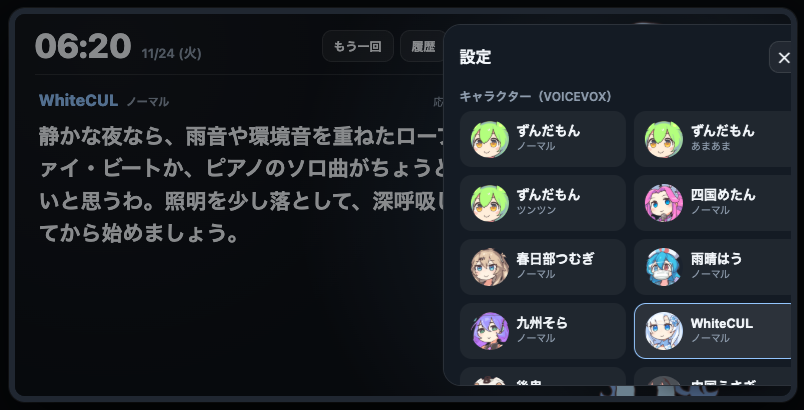

# VoxDesk

Echo Show 5 などの小型ディスプレイ向けに最適化された、VOICEVOX × mlx-whisper × `agy` 連携の音声対話 Web アプリケーションです。

## スクリーンショット

> 以下は Echo Show 5 実機表示比率（`788×394` CSS / `960×480` 物理）におけるサンプル会話画面です。

| ずんだもん | 春日部つむぎ |
| :---: | :---: |
|  |  |

| WhiteCUL | 設定画面（キャラクター選択） |
| :---: | :---: |
|  |  |

## 構成

- **STT**: `mlx-whisper` (`mlx-community/whisper-large-v3-turbo-q4`)
- **LLM**: `agy` (`--input-format stream-json` 常駐セッション)
- **TTS**: VOICEVOX Engine (`http://127.0.0.1:50021`)
- **UI**: 左ペイン会話テキスト + 右ペイン立ち絵リップシンク（`788×394` / `960×480` 最適化）

## セットアップ（ローカル素材・バイナリの配置）

パブリックリポジトリには再配布不可の立ち絵画像や大容量の VOICEVOX Engine 本体は含めていません。利用前に以下を配置してください。

1. `voicevox/macos-arm64/` に VOICEVOX Engine を配置
2. `static/portraits/` に各キャラクター立ち絵・アイコン PNG（`<asset>_{idle,speak,blink,happy,think,icon}.png`）を配置
3. 依存パッケージを同期して起動:

```bash
uv sync
./start.sh
```

## クレジット・権利表記

- **立ち絵イラスト（スクリーンショット内）**: 坂本アヒル 氏（[ニコニコ静画 im10788496](https://seiga.nicovideo.jp/seiga/im10788496) ほか VOICEVOX キャラクター立ち絵素材）
  - 各キャラクターの立ち絵素材は、配布元の利用規約に基づき本リポジトリには含めていません。
- **音声合成**: [VOICEVOX](https://voicevox.hiroshiba.jp/)
  - ずんだもん、四国めたん、春日部つむぎ、雨晴はう、九州そら、WhiteCUL、後鬼、中国うさぎ、東北ずん子、東北イタコ、あんこもん、ブイブイ・コバコ（各キャラクターの利用規約に準拠します）。

## ライセンス・セキュリティ

- 本リポジトリのソースコードは [MIT License](LICENSE) のもとで公開しています（外部の音声・立ち絵素材の権利は各権利者に帰属します）。
- 脆弱性報告や運用上の注意については [SECURITY.md](SECURITY.md) をご覧ください。
